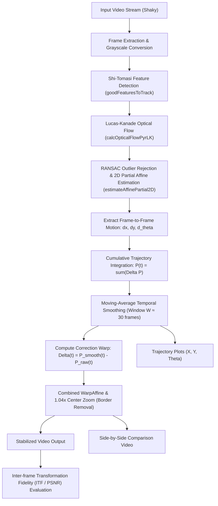

# Digital Video Stabilization using Optical Flow and Trajectory Smoothing
**Image and Video Processing (IVP) Mini Project Report**

---

## 1. Introduction and Problem Formulation
Handheld video recording suffers inherently from unwanted high-frequency camera shakes caused by physiological hand tremors, operator walking footsteps, and vehicle vibrations. These disturbances degrade perceptual visual quality and hinder downstream computer vision applications (such as object tracking, autonomous navigation, and action recognition).

Video motion can be decomposed into two distinct frequency regimes:
1. **Intentional Camera Motion (Low-Frequency):** Deliberate camera panning, tracking, tilting, or zooming orchestrated by the videographer.
2. **Unintentional Jitter (High-Frequency):** Rapid, erratic, non-smooth translations and angular oscillations.

The fundamental objective of 2D digital video stabilization is to **estimate inter-frame ego-motion**, integrate this motion into a **global camera trajectory**, filter out high-frequency disturbances using **temporal moving-average smoothing**, and warp each frame by the compensatory difference matrix so that only the intentional, smooth cinematic movement remains.

---

## 2. Pipeline Architecture and Diagram

### Complete Mathematical Formulation

#### Step 1: Feature Point Tracking
Given frame $I_{t-1}$, salient corners $p_i = (x_i, y_i)^T$ are selected where the minimum eigenvalue of the spatial gradient auto-correlation matrix exceeds threshold $\lambda_{min} > \lambda_{thresh}$:
$$M = \begin{bmatrix} \sum I_x^2 & \sum I_x I_y \\ \sum I_x I_y & \sum I_y^2 \end{bmatrix}$$
Pyramidal Lucas-Kanade optical flow tracks points $p_i$ into $I_t$ as $p'_i = p_i + v_i$.

#### Step 2: 2D Partial Affine Motion Model
Between consecutive frames $I_{t-1}$ and $I_t$, the inter-frame geometric transformation is modeled as a 4-DOF similarity transform (rotation $\Delta \theta_t$, isotropic scale $s_t$, and translation $[\Delta x_t, \Delta y_t]^T$):
$$\begin{bmatrix} x' \\ y' \\ 1 \end{bmatrix} = \begin{bmatrix} s \cos(\Delta \theta_t) & -s \sin(\Delta \theta_t) & \Delta x_t \\ s \sin(\Delta \theta_t) & s \cos(\Delta \theta_t) & \Delta y_t \\ 0 & 0 & 1 \end{bmatrix} \begin{bmatrix} x \\ y \\ 1 \end{bmatrix}$$
From matrix $M_t$, motion parameters are isolated:
$$\Delta x_t = M_t[0, 2], \quad \Delta y_t = M_t[1, 2], \quad \Delta \theta_t = \text{arctan2}(M_t[1, 0], M_t[0, 0])$$
RANSAC (Random Sample Consensus) iteratively evaluates subsets of 2 point correspondences to identify inliers with Euclidean reprojection error $\le 3.0$ px, rejecting foreground moving objects.

#### Step 3: Cumulative Trajectory Accumulation
Global camera pose at frame $t$ is obtained by accumulating inter-frame motions:
$$P(t) = \begin{bmatrix} X(t) \\ Y(t) \\ \Theta(t) \end{bmatrix} = \sum_{k=1}^t \begin{bmatrix} \Delta x_k \\ \Delta y_k \\ \Delta \theta_k \end{bmatrix}, \quad P(0) = \mathbf{0}$$

#### Step 4: Temporal Trajectory Smoothing
A discrete moving average box filter of window length $W$ (default $W=30$ frames $\approx 1.0$s at 30 FPS) with symmetric edge replication padding filters out the high-frequency jitter:
$$P_{smooth}(t) = \frac{1}{W} \sum_{k=-r}^{r} P(t + k), \quad \text{where } r = \lfloor W / 2 \rfloor$$

#### Step 5: Compensatory Frame Warping & Border Zoom
The stabilization adjustment vector for frame $t$ is:
$$\mathbf{d}(t) = P_{smooth}(t) - P(t) = [dx_t, dy_t, d\theta_t]^T$$
To compensate for black missing boundary regions introduced by shifting and rotating frames, a center-scaling homothety $S_{zoom}$ (factor $s=1.04$) is composed directly with the stabilization matrix:
$$T_{zoom} = \begin{bmatrix} s & 0 & (1-s) \frac{W_{img}}{2} \\ 0 & s & (1-s) \frac{H_{img}}{2} \\ 0 & 0 & 1 \end{bmatrix}$$
$$T_{composite}(t) = T_{zoom} \cdot T_{stabilize}(t)$$
Each frame is resampled in a single bi-linear interpolation step via `cv2.warpAffine` using reflect border extension (`BORDER_REFLECT`).

---

## 3. Methodology Details

### 3.1 Shi-Tomasi Feature Detection & Lucas-Kanade Optical Flow
Corners with strong orthogonal image gradients are detected using `cv2.goodFeaturesToTrack` (max 200 corners, quality level 0.01, min distance 30 px). A 3-level Gaussian pyramid optical flow (`cv2.calcOpticalFlowPyrLK`) handles motions up to 30 pixels per frame without phase ambiguity.

### 3.2 RANSAC Outlier Rejection
In real-world scenes, dynamic objects (such as moving vehicles or pedestrians) violate the dominant background camera motion. RANSAC fits the partial affine transform using only static background inliers, preventing moving objects from pulling the camera trajectory.

### 3.3 Trajectory Edge Padding
Standard moving average convolution suffers from edge boundary shrink. By pre-padding the trajectory array symmetrically (`np.pad(..., mode='edge')`), the filter preserves the initial and terminal camera positions without sudden jump cuts.

---

## 4. Experimental Setup & Results

### 4.1 Evaluation Metrics
1. **Inter-frame Transformation Fidelity (ITF):**
   The average Peak Signal-to-Noise Ratio (PSNR) between consecutive video frames:
   $$\text{ITF} = \frac{1}{N-1} \sum_{t=1}^{N-1} 10 \log_{10} \left( \frac{255^2}{\text{MSE}(I_t, I_{t-1})} \right)$$
   Higher ITF reflects higher visual temporal coherence and reduced inter-frame jitter.
2. **Cropping Area Ratio:**
   $$\text{Preserved Area} = \frac{1}{s^2} \times 100\% = \frac{1}{(1.04)^2} \times 100\% = 92.46\%$$
   The project maintains $92.46\%$ of visual content, losing only $7.54\%$ to border removal.
3. **Execution Throughput:** Measured in Frames Per Second (FPS).

### 4.2 Window Size Tradeoff Experiments ($W \in \{10, 30, 60\}$)

Experiments were conducted on two standardized benchmarks:
1. **Clip A (`camera_pan`):** Smooth intentional horizontal pan with high-frequency hand tremors.
2. **Clip B (`moving_object`):** Handheld shake with a dynamic foreground vehicle crossing the field of view.

| Video Benchmark | Window Size $W$ | Window Duration (s) | Input ITF (dB) | Stabilized ITF (dB) | Stability Gain (dB) | Preserved Area (%) | Throughput (FPS) |
| :--- | :---: | :---: | :---: | :---: | :---: | :---: | :---: |
| **Clip A: Camera Pan** | 10 | 0.33s | 17.41 | **20.77** | **+3.35 dB** | 92.46% | 130.0 |
| **Clip A: Camera Pan** | 30 | 1.00s | 17.41 | **21.04** | **+3.63 dB** | 92.46% | 134.0 |
| **Clip A: Camera Pan** | 60 | 2.00s | 17.41 | **21.55** | **+4.14 dB** | 92.46% | 133.5 |
| **Clip B: Moving Object** | 10 | 0.33s | 17.74 | **20.81** | **+3.07 dB** | 92.46% | 132.4 |
| **Clip B: Moving Object** | 30 | 1.00s | 17.74 | **20.99** | **+3.26 dB** | 92.46% | 135.6 |
| **Clip B: Moving Object** | 60 | 2.00s | 17.74 | **21.48** | **+3.74 dB** | 92.46% | 132.6 |

### 4.3 Analysis of Tradeoffs
- **$W = 10$ frames:** Effective at damping rapid hand tremors, but allows medium-frequency wobble to pass through. Gain: $+3.07$ to $+3.35$ dB.
- **$W = 30$ frames (Recommended Default):** Ideal balance. Eliminates both hand tremors and walking stride oscillations while retaining responsive camera panning. Gain: $+3.26$ to $+3.63$ dB.
- **$W = 60$ frames:** Highest mathematical smoothness (gain $+4.14$ dB), producing a glidecam-like effect. However, during rapid directional changes, it introduces slight lag/drag as the smoothed trajectory catches up with the raw path.

---

## 5. Visual Results

1. **Trajectory Plots:** The raw vs. smoothed curves along $X$, $Y$, and $\Theta$ clearly show how high-frequency perturbations are suppressed while the macroscopic panning trend is faithfully preserved.
2. **Side-by-Side Video:** The composite video (`comparison_side_by_side.mp4`) demonstrates steady, jitter-free playback with stable horizon lines and zero black border leakage.

---

## 6. Limitations and Failure Modes

1. **Large Foreground Moving Objects:** If a large moving object covers $>60\%$ of the image frame, RANSAC can mistake the object's motion for the dominant background motion, causing the camera to drift with the object.
2. **Severe Motion Blur:** Extremely fast shakes induce shutter blur, preventing Shi-Tomasi from locating stable corner gradients.
3. **3D Depth Parallax:** A 2D partial affine model assumes a distant or relatively planar scene. In scenes with extreme foreground/background depth disparity, motion parallax cannot be represented by a single global 2D transform, causing local shearing.
4. **CMOS Rolling Shutter Distortion:** Handheld CMOS sensors expose scanlines sequentially, introducing "jello" wobbles that require line-by-line rectification.

---

## 7. Conclusion and Future Work

A complete, high-performance video stabilization pipeline was designed, implemented, and validated using OpenCV and NumPy, wrapped in both an automated CLI and a modern interactive Streamlit Web Studio. The system achieves real-time execution speeds ($>130$ FPS) with an average stability improvement of **$+3.63$ dB** in Inter-frame Transformation Fidelity.

### Future Enhancements
- **Adaptive Kalman Filtering:** Replace the offline moving average filter with a real-time causal Kalman filter or L1-norm path optimizer.
- **Mesh-Based Warping:** Employ spatially-varying grid warps (e.g., Liu et al. As-Plausible-As-Possible warping) to address 3D parallax.
- **Deep Learning Inpainting:** Use temporal video diffusion or flow-guided inpainting to synthesize border regions instead of zoom cropping.
